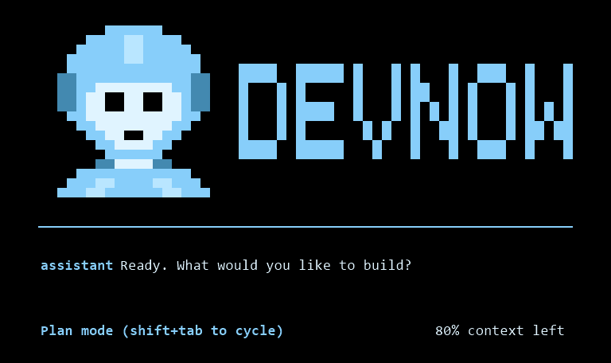

<p align="center">
  
</p>

<p align="center">
  An open-source, terminal-first AI software engineering agent with single-agent and multi-agent workflows.
</p>

<p align="center">
  <a href="LICENSE"></a>
  <a href="https://github.com/DEVN0W/DevNow-Agent/issues"></a>
  <a href="https://github.com/DEVN0W/DevNow-Agent/pulls"></a>
  <a href="https://github.com/DEVN0W/DevNow-Agent/issues/new"></a>
</p>

DevNow Agent works inside your local project, can edit and run code, and supports three operating modes: **Single AI**, **Multi-Agent**, and **Multi-Agent Strategic**. It is designed for developers who want a configurable agent experience that can use different model providers and specialized agent teams.

DevNow Agent was created from the open-source code of [OpenAI Codex](https://github.com/openai/codex) and has been independently customized with DevNow branding, BYOAI provider support, and DevNow's multi-agent workflows. DevNow Agent is not presented as an official OpenAI product; the original copyright and attribution notices are retained in [NOTICE](NOTICE).



## Highlights

- A branded terminal UI built for day-to-day development work
- Single-agent mode for focused tasks
- Manual multi-agent delegation with `@agent-name`
- Strategic multi-agent workflows with configurable routing and review loops
- Bring Your Own AI (BYOAI) with Claude, OpenAI, Azure OpenAI, Azure AI Foundry, compatible endpoints, or local Ollama models
- Configurable models, sandboxing, and approval policies
- MCP server support and non-interactive execution
- Open-source under the Apache License 2.0

## Bring Your Own AI (BYOAI)

DevNow does not lock your agents to one AI provider. A single installation can use different providers for different agents:

- **Claude** through the DevNow gateway
- **OpenAI** and OpenAI-compatible APIs
- **Azure OpenAI** deployments
- **Azure AI Foundry** projects and agents
- **Ollama** for local or private AI deployments
- **LM Studio** for locally hosted models

> **Interested in the private Ollama version?** DevNow offers a licensed private-AI deployment for organizations that want prompts and model traffic to remain within infrastructure they control. [Inquire with the DevNow team](https://github.com/DEVN0W/DevNow-Agent/issues/new) for access, licensing, and deployment options.

The models you select remain subject to their respective provider and model licenses.

## Requirements

- Git 2.23 or newer
- Rust stable, including Cargo, `rustfmt`, and Clippy
- 4 GB RAM minimum; 8 GB recommended
- macOS 12+, Ubuntu 20.04+/Debian 10+, or Windows 11

On Windows, PowerShell can build the project natively. WSL2 is recommended when you want a Linux development environment.

## Install from source

### 1. Clone the project

```bash
git clone --branch master https://github.com/DEVN0W/DevNow-Agent.git
cd DevNow-Agent/devnow-rs
```

### 2. Install Rust

Install Rust with [rustup](https://rustup.rs/), then add the required components:

```bash
rustup component add rustfmt clippy
```

### 3. Build a release binary

```bash
cargo build --release --bin codex
```

The Rust workspace currently produces an internal binary named `codex`. Install that artifact under the public `devnow` command:

macOS or Linux:

```bash
mkdir -p "$HOME/.local/bin"
cp target/release/codex "$HOME/.local/bin/devnow"
chmod +x "$HOME/.local/bin/devnow"
export PATH="$HOME/.local/bin:$PATH"
```

Windows PowerShell:

```powershell
$devNowBin = "$env:LOCALAPPDATA\DevNow\bin"
New-Item -ItemType Directory -Force $devNowBin | Out-Null
Copy-Item .\target\release\codex.exe "$devNowBin\devnow.exe"
$env:Path = "$devNowBin;$env:Path"
```

Add the chosen binary directory to your shell profile or user `PATH` to keep the `devnow` command available after restarting the terminal.

### 4. Create a DevNow configuration directory

DevNow supports a custom configuration home through `CODEX_HOME`. Set it to a DevNow-owned directory so your settings stay separate from other tools.

macOS or Linux:

```bash
export CODEX_HOME="$HOME/.devnow"
mkdir -p "$CODEX_HOME"
```

Windows PowerShell:

```powershell
$env:CODEX_HOME = "$HOME\.devnow"
New-Item -ItemType Directory -Force $env:CODEX_HOME | Out-Null
```

Persist `CODEX_HOME` in your shell profile or operating-system environment variables if you want to use the same location in future sessions.

### 5. Configure a model provider

Create `$CODEX_HOME/config.toml`. Never commit real API keys; store credentials in environment variables.

Basic configuration:

```toml
model = "YOUR_MODEL_NAME"
approval_policy = "on-request"
sandbox_mode = "workspace-write"
```

For an OpenAI-compatible endpoint, add a provider:

```toml
model = "YOUR_MODEL_NAME"
model_provider = "my-provider"
approval_policy = "on-request"
sandbox_mode = "workspace-write"

[model_providers.my-provider]
name = "My Provider"
base_url = "https://YOUR-ENDPOINT.example/v1"
env_key = "DEVNOW_API_KEY"
wire_api = "responses"
```

Then set the credential in your terminal:

```bash
export DEVNOW_API_KEY="your-api-key"
```

Windows PowerShell:

```powershell
$env:DEVNOW_API_KEY = "your-api-key"
```

Azure OpenAI example:

```toml
model = "YOUR_AZURE_DEPLOYMENT_NAME"
model_provider = "azure-openai"

[model_providers.azure-openai]
name = "Azure OpenAI"
base_url = "https://YOUR-RESOURCE.openai.azure.com/openai"
env_key = "AZURE_OPENAI_API_KEY"
wire_api = "responses"
query_params = { api-version = "YOUR_SUPPORTED_API_VERSION" }
```

Set `AZURE_OPENAI_API_KEY` in your environment before starting DevNow. Model names, endpoints, and API versions must match the provider account you use.

Azure AI Foundry example:

```toml
model = "YOUR_MODEL_OR_AGENT_NAME"
model_provider = "azure-foundry"

[model_providers.azure-foundry]
name = "Azure AI Foundry"
base_url = "https://YOUR-PROJECT-ENDPOINT/api/projects/YOUR-PROJECT/openai/v1"
env_key = "AZURE_FOUNDRY_API_KEY"
wire_api = "responses"
```

For a Foundry agent, add the provider-specific reference required by your project:

```toml
extra_body = { agent_reference = { name = "YOUR-AGENT", version = "YOUR-VERSION", type = "agent_reference" } }
```

Claude example:

```toml
model = "YOUR_CLAUDE_MODEL"
model_provider = "claude"
```

Set `DEVNOW_CLAUDE_API_KEY` before starting DevNow. You can optionally set `DEVNOW_CLAUDE_BASE_URL` when using a compatible managed endpoint.

For private or local AI with Ollama, start Ollama and launch DevNow in local-model mode:

```bash
ollama serve
devnow --oss --local-provider ollama
```

### 6. Start DevNow

Open the project you want the agent to work on and run:

```bash
cd /path/to/your/project
devnow
```

Or start with an initial request:

```bash
devnow "explain this project and suggest the first improvement"
```

## Configure operating modes

Use `/mode` inside the terminal UI to select a workflow. `/plan` remains available for planning within any mode.

### Single AI

Single AI is the default. It uses the model and provider from `$CODEX_HOME/config.toml`; no additional roster file is required.

### Multi-Agent

Multi-Agent gives you manual control over a team. Copy the included sample roster:

macOS or Linux:

```bash
cp ../docs/agentic.sample.toml "$CODEX_HOME/agentic.toml"
```

Windows PowerShell, when run from `devnow-rs`:

```powershell
Copy-Item ..\docs\agentic.sample.toml "$env:CODEX_HOME\agentic.toml"
```

Edit each agent's `model` and `model_provider` to match your configuration. Select **Multi-Agent** with `/mode`, then address an agent at the beginning of a prompt:

```text
@developer implement the requested API and add focused tests
```

Multiple leading mentions can dispatch independent assignments:

```text
@principal-architect @developer review the design and implementation in parallel
```

### Multi-Agent Strategic

Strategic mode runs an automatic workflow containing roles such as architect, planner, developer, critic, security, quality, execution, and judge.

Copy the strategic sample:

macOS or Linux:

```bash
cp ../docs/multi-agent.sample.toml "$CODEX_HOME/multi_agent.toml"
```

Windows PowerShell, when run from `devnow-rs`:

```powershell
Copy-Item ..\docs\multi-agent.sample.toml "$env:CODEX_HOME\multi_agent.toml"
```

Update the model/provider values, restart DevNow, and choose **Multi-Agent Strategic** from `/mode`.

## Screenshots

### Terminal experience


## Development

From `devnow-rs`:

```bash
cargo test -p codex-tui
cargo test -p codex-tui-app-server
just fmt
just argument-comment-lint
```

See [Contributing](docs/contributing.md) for the complete workflow. User configuration examples are available in [docs/config.md](docs/config.md), [docs/agentic.sample.toml](docs/agentic.sample.toml), and [docs/multi-agent.sample.toml](docs/multi-agent.sample.toml).

## Open-source project

Bug reports, feature proposals, documentation improvements, and pull requests are welcome. Please read the [contribution guide](docs/contributing.md) and [security policy](SECURITY.md) before participating.

DevNow Agent is licensed under the [Apache License 2.0](LICENSE). It was created from the open-source OpenAI Codex codebase and includes substantial DevNow-specific customization. Required original copyright and third-party attribution notices are retained in [NOTICE](NOTICE).
